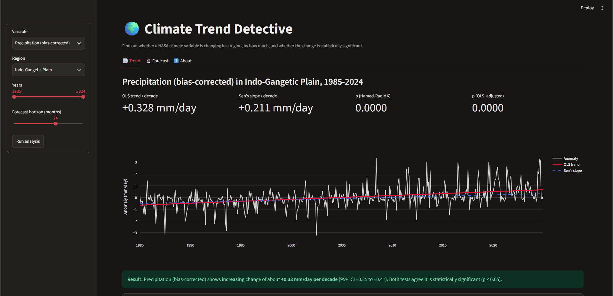
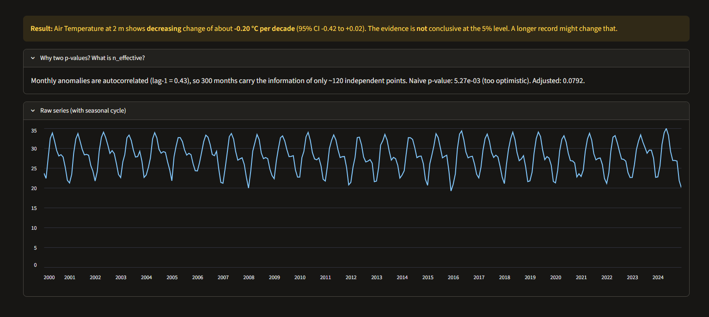
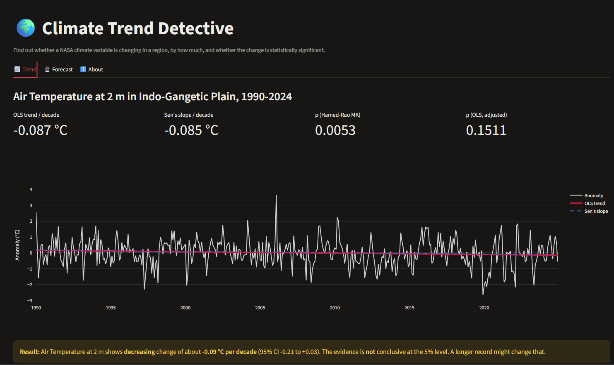
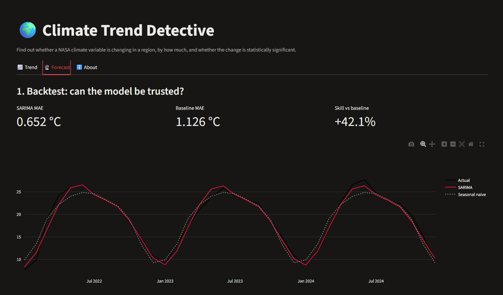

# 🌍 Climate Trend Detective

A web app that answers three questions about a NASA climate variable in a region:
**what is changing, by how much, and is the change statistically significant?**
It also forecasts the next 1-3 years and checks the forecast against a simple baseline.

**Live app:** <your-streamlit-link>
**Built for:** NASA Space Apps Challenge 2026 (Earth science trend-detection challenge)
**Author:** <your-name>


*Precipitation in the Indo-Gangetic Plain, 1985-2024: both tests agree the trend is significant. See the caveat under Limitations.*

## What it does
1. Pick a **variable** (2 m air temperature, bias-corrected precipitation, root-zone soil wetness) and a **region** (Indo-Gangetic Plain, Sahel, Amazon Basin, Central Australia).
2. The app downloads the monthly NASA data, averages it over the region, and removes the seasonal cycle.
3. It estimates the **rate of change per decade** and tests whether the change is **statistically significant**.
4. It forecasts the next months with SARIMA and shows how the forecast performed on data it had not seen.

Each variable has a plain-language definition on the About tab, so the tool works for students and non-specialists.

## Data
Monthly data from the [NASA POWER API](https://power.larc.nasa.gov/), which provides parameters derived from the **MERRA-2** reanalysis, with precipitation bias-corrected using **GPM IMERG**.
A reanalysis blends satellite and ground observations into a physical model to give a complete, gap-free record. It is model-assisted, not a raw measurement.
Each regional value is the mean of a 3×3 grid of points inside the region's bounding box. Results are cached locally after the first download.

## Methods
1. **Deseasonalising:** each calendar month's long-term mean is subtracted, leaving anomalies.
2. **OLS trend:** slope per decade with a 95% confidence interval.
3. **Autocorrelation correction:** monthly anomalies are not independent, so the effective sample size is n_eff = n(1 − r₁)/(1 + r₁), where r₁ is the lag-1 autocorrelation of the residuals. This widens the standard error and gives an adjusted p-value.
4. **Mann-Kendall and Sen's slope:** rank-based and robust, with no normality assumption. The Hamed-Rao modification corrects for autocorrelation.
5. **Verdict rule:** a trend is reported as significant only if the Hamed-Rao Mann-Kendall test **and** the adjusted OLS test both give p < 0.05.
6. **Forecasting:** SARIMA(1,1,1)(1,1,1)₁₂, evaluated on the final 36 months (a chronological split, so there is no leakage) and compared with a seasonal-naive forecast using mean absolute error (MAE).

## Results

| Case | Result |
|---|---|
| Synthetic data with a planted trend of 0.300 per decade | OLS 0.316 (95% CI 0.217 to 0.416), Sen's slope 0.318; n = 420, n_eff = 124; correctly detected as increasing |
| Sahel temperature, 2000-2024 | -0.20 °C/decade (95% CI -0.42 to +0.02); naive p = 0.005 but autocorrelation-adjusted p = 0.08, so **not significant** |
| Indo-Gangetic temperature, 1990-2024 | -0.09 °C/decade (95% CI -0.21 to +0.03); Hamed-Rao p = 0.005 but adjusted OLS p = 0.15, so the tests disagree and the result is **not conclusive** |
| Indo-Gangetic precipitation, 1985-2024 | +0.33 mm/day per decade (95% CI +0.25 to +0.41), Sen's slope +0.21; both tests p < 0.0001, **significant** (see caveat) |
| Indo-Gangetic temperature forecast | SARIMA MAE 0.652 °C vs seasonal-naive 1.126 °C: **+42.1% skill** on a 36-month hold-out |

### Why the non-significant cases matter
Ignoring autocorrelation would have declared a significant cooling trend in the Sahel (naive p = 0.005) that the data does not support (adjusted p = 0.08). The tool reports "not conclusive" rather than forcing a verdict.


*Sahel temperature, 2000-2024: 300 months carry the information of only about 120 independent points (lag-1 autocorrelation = 0.43).*


*Indo-Gangetic temperature, 1990-2024: the two tests disagree, so the result is reported as not conclusive.*


*Indo-Gangetic temperature: SARIMA against a seasonal-naive baseline on 36 held-out months.*

## Run locally
```bash
git clone https://github.com/aayushvardhan/nasa-trend-detective.git
cd nasa-trend-detective
python -m venv .venv
.venv\Scripts\activate          # Mac/Linux: source .venv/bin/activate
pip install -r requirements.txt
python test_stats.py            # validates the statistics on synthetic data
streamlit run app.py
```

## Project structure
```
app.py              Streamlit interface (Trend, Forecast, About tabs)
src/catalog.py      Variable definitions and region bounding boxes
src/data_loader.py  NASA POWER download, parsing, caching, regional averaging
src/processing.py   Seasonal-cycle removal
src/trend.py        OLS, autocorrelation correction, Mann-Kendall, Sen's slope
src/forecast.py     SARIMA, seasonal-naive baseline, backtest
test_stats.py       Checks the statistics recover a known planted trend
```

## Limitations
- Only **linear** trends are modelled. Step changes and non-linear change are not.
- **Precipitation caveat:** the Indo-Gangetic precipitation series shows a visible rise in variability after about 2000, and OLS and Sen's slopes differ. This may reflect a change in the underlying input data rather than a smooth climate trend. This has not been investigated, so treat that result with caution.
- Regional values are plain grid averages, not area-weighted.
- Reanalysis data is model-assisted and can differ from station observations.
- Forecast skill varies by variable and region, and prediction intervals rely on SARIMA's assumptions.
- The most recent months of NASA POWER data may be preliminary.
- Short windows cannot show reliable climate trends. A significant slope over a few years mostly reflects short-term variability.

## Possible extensions
Per-pixel trend maps, more regions and variables, gridded MERRA-2/GLDAS access through `earthaccess`, and a gradient-boosting forecaster to compare against SARIMA.

## Use of AI tools (SI disclosure)
Code was developed with assistance from Claude (Anthropic) under the author's direction. The author selected the challenge, validated the outputs, and is responsible for the project.

Claude was used for code scaffolding, debugging, and explanations of the statistical methods. The author ran and tested the code, checked the results, took the screenshots, and decided what to include.

## Acknowledgements
NASA POWER, MERRA-2 (NASA GMAO), GPM IMERG. Built with Python, pandas, NumPy, SciPy, statsmodels, pymannkendall, Plotly, and Streamlit.